# Movie Watchlist Test Gallery

Screenshots from Postman and the terminal proving each route and test works. The API runs at `http://localhost:3001`.

## 1. Listing all items

`GET /movies` (no token needed) returns **200 OK** with every movie.

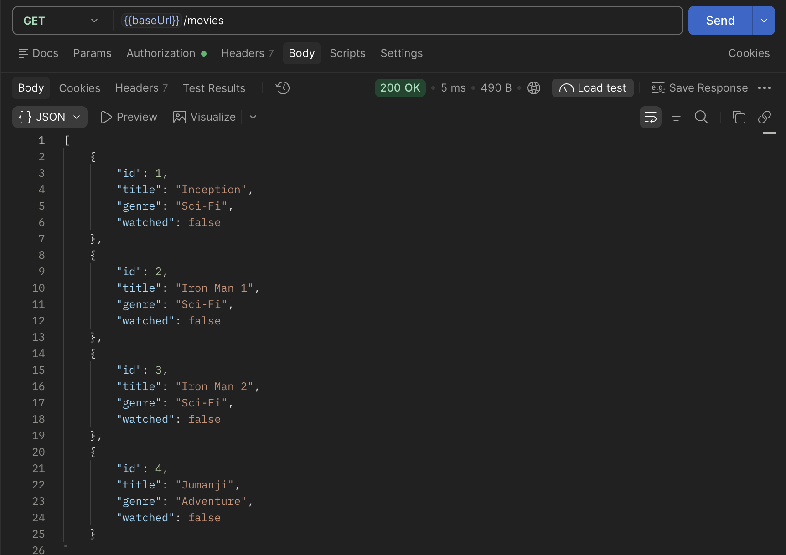

## 2. Getting one item

`GET /movies/1` returns **200 OK** with the one movie.

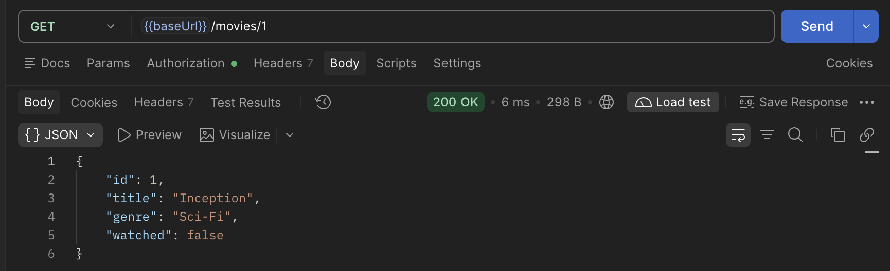

## 3. Creating an item

`POST /movies` with a token and body `{ "title": "Inception", "genre": "Sci-Fi" }` returns **201 Created** with the new movie (`watched` is `false`).

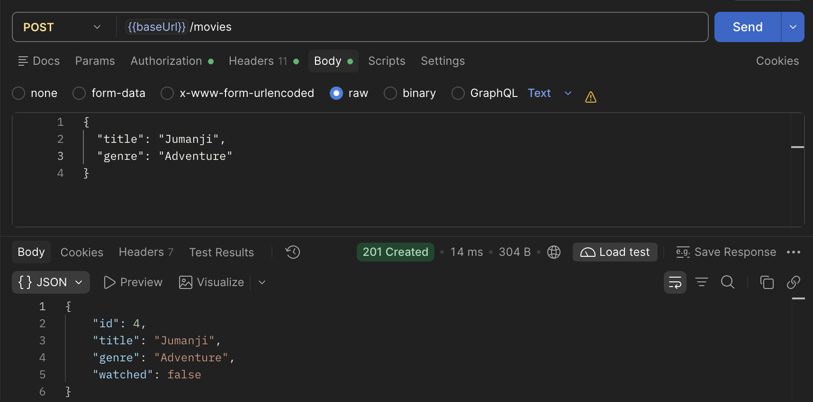

**Validation error:** the same request with an empty title, `{ "title": "", "genre": "Sci-Fi" }`, returns **400 Bad Request** with `"title should not be empty"`.

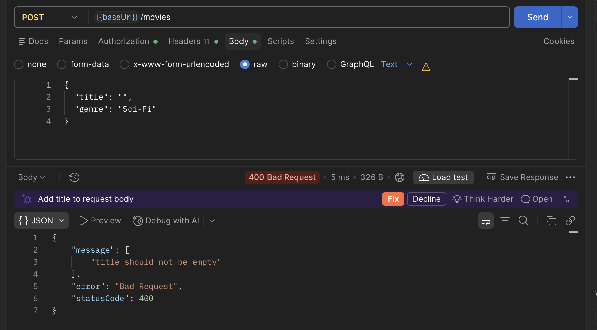

## 4. Updating an item

`PATCH /movies/1` with a token and body `{ "watched": true }` returns **200 OK** with `watched` now `true`.

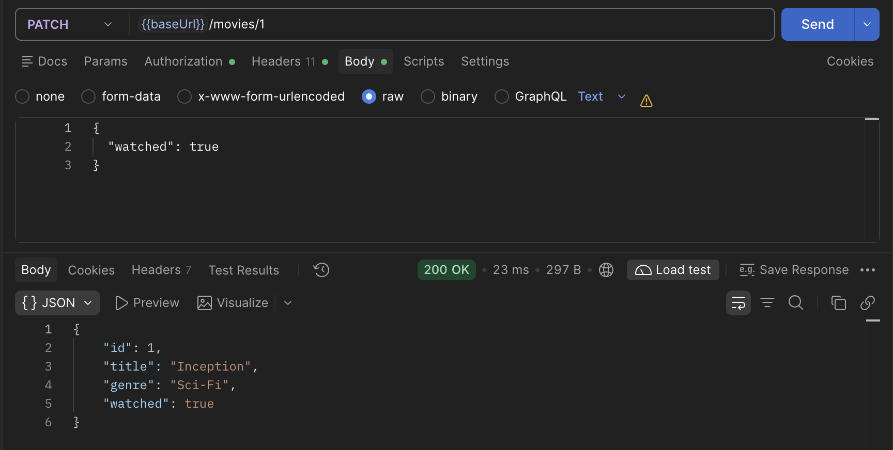

## 5. Deleting an item

`DELETE /movies/2` with a token returns **200 OK** with `{ "message": "Movie deleted" }`.

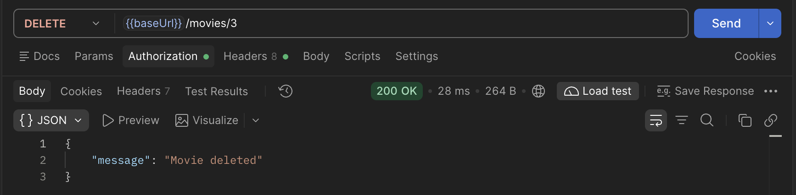

## 6. 404 for a missing item

`GET /movies/99` returns **404 Not Found** with `"Movie with id 99 not found"`.

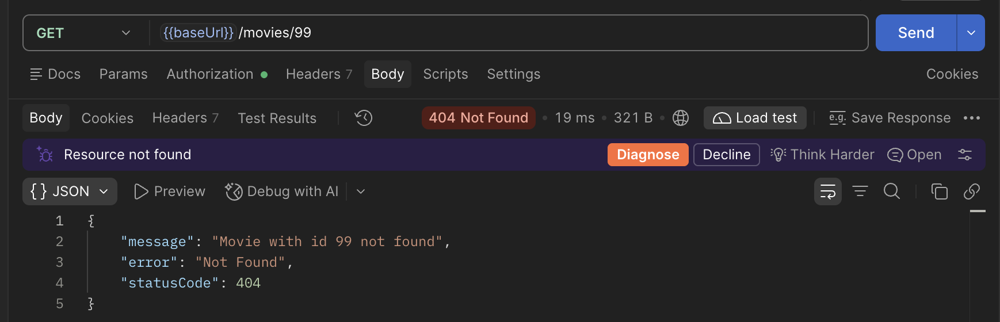

## 7. 401 without a token, success with one

`POST /movies` with **no token** returns **401 Unauthorized** with `"Missing token"`.

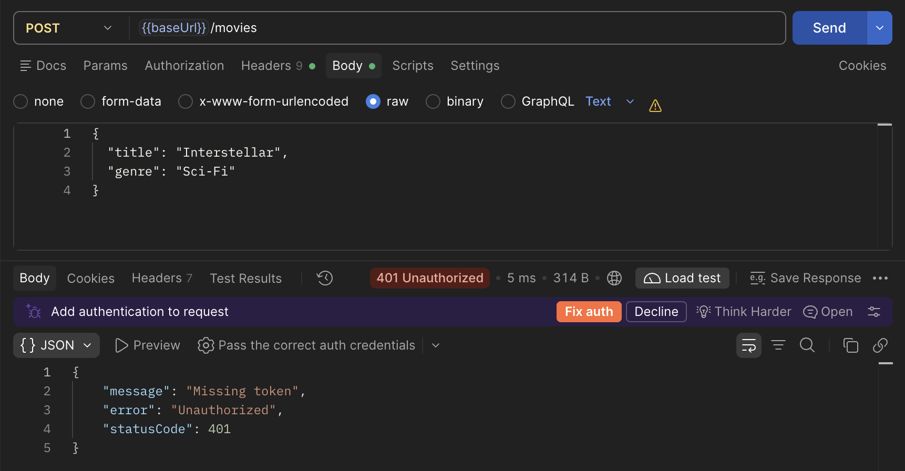

The same request **with** a Bearer token returns **201 Created**.

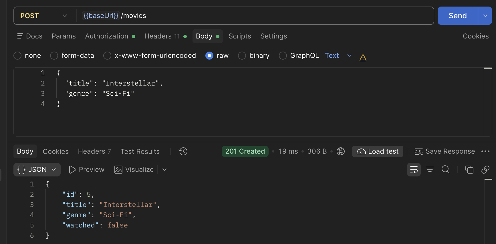

## 8. Tests passing

**Unit tests:** `npm run test` runs 1 file and 8 tests, all passing.

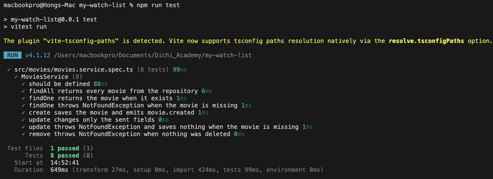

**E2E tests:** `npm run test:e2e` runs 1 file and 9 tests, all passing.

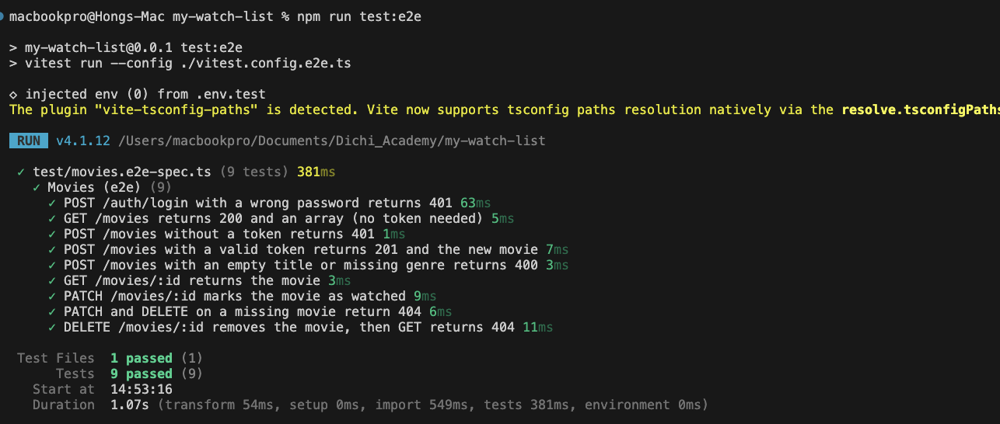
